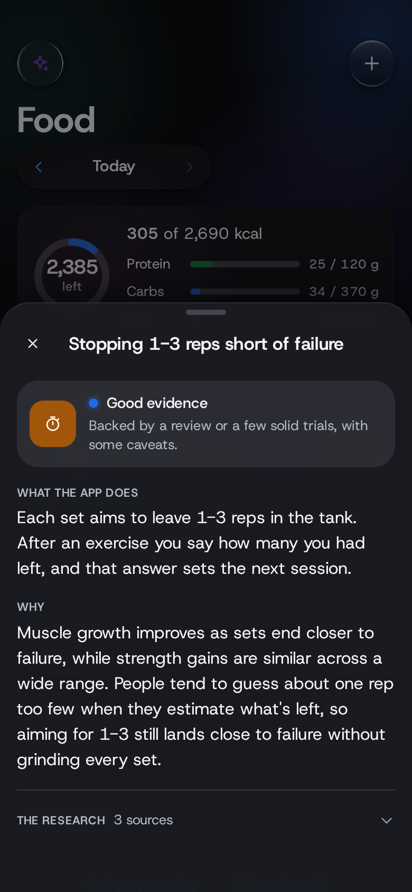

# Gradient Health

**Workouts that adjust to you, every day. At home or at the gym.**

Gradient Health plans a workout for each day of your week around your goals, the equipment you have and the time you've got. A 3D figure shows you every move. After each exercise it asks one question, and your answer, together with how you slept and recovered, decides what you do next time. Track your food too if you want, or just your health.

  
  
  
  

## A plan that fits your life

Tell Gradient Health what you want (visible abs, bigger arms, stronger legs, just showing up more), how many days you can train and for how long. It builds a week from that, with your top goals trained most and done first, while you're fresh. Ten minutes or an hour, two days a week or six, a pair of dumbbells or nothing at all: the plan works with what you have.

## At home or at the gym

Tell it what your gym has (barbells, a rack, cables, machines, a full dumbbell rack) and gym days use it: bench press, squats, pulldowns, cable work and 40-odd more, each with a starting weight that's on the light side. Hit the top of your reps with some left in the tank and the weight goes up next time. Train at both? Switch today's workout between home and gym with one tap, and each keeps its own progress. Changing your equipment later is one screen, not a new set-up.

Miss a day and the rest of the week moves forward instead of doubling up. Short on time? One tap turns today's session into a real 12 to 15 minute version.

## One question makes it smarter

After each exercise you get asked how many more reps you could have done. That's it. Answer 0 and it holds you steady, 1 or 2 and it adds a little, 3 or more and it moves you up: more reps first, then a heavier weight, then a harder version of the move. When you've outgrown your heaviest dumbbell, it tells you what to buy next.

  
  
  

## Easier on the days you need it

Slept under five hours? Resting heart rate well above your normal, or HRV well below it? Sore and low on energy? Gradient Health takes a set off each exercise that day, so you keep the habit without digging a hole. Went for a long run yesterday? Your legs get a lighter day. Every fifth week is a lighter deload week, and it comes sooner if you're run down.

## Food, if you want it

Turn on calorie tracking and you get a daily target worked out from your size, your steps and your goal, which tunes itself once you've logged for a couple of weeks and weighed in. Log from a built-in list of common foods, your own foods from a label, saved meals or a quick number. Online search and barcode scanning (from Open Food Facts) are there if you switch them on. Prefer just a protein goal? That's one setting. Only want food and health, no workouts? That works too.

  
  
  

## Your health in one place

Connect Health Connect and your sleep, steps, weight, heart rate, HRV, active calories, distance and workouts from other apps flow in on their own. If your watch app doesn't share a resting heart rate, Gradient Health estimates one from your heart rate overnight. Gradient Health syncs every time you open it and every 15 minutes while it's open, and you can pull down to sync right away. It can also save your workouts and meals back to Health Connect so your other apps see them.

You get trends over 7, 28 and 90 days, and insights that only show up when there's enough data to back them: a week of short sleep, a resting heart rate creeping up, a weight trend moving faster than it should.

## A coach you can see

The coach never changes your plan quietly. Today's card says what it changed and why ("1 set off each exercise: 5 h 10 m of sleep"), and the Coach page shows its suggestions (you apply them or not), what it's keeping an eye on, and every change it made lately.

Ask it anything about your numbers three ways. The built-in coach answers common questions instantly, offline. An AI model that runs on your phone answers anything, and nothing you ask leaves the phone. Or use Claude: tap Ask in the Claude app and your question plus a summary of your data (no name, no dates) opens there, or add an Anthropic API key and Claude answers in the app and writes your weekly report.

## Catch up a weaker side

If one arm or leg is weaker, it goes first, the other side never does more reps, and it gets one extra set. A quick left vs right test every two weeks shows the gap closing, and the extra set switches off once it's under 10%.

## Built on research, and honest about it

Every rule Gradient Health follows, from how many sets you do to how long you rest, is listed in the app with the studies behind it and a plain rating of how strong that evidence is. Where the research is thin, it says so.

  
  

## Private by design

No account, no ads and no analytics. Everything stays on your phone. The only things that ever leave it are ones you choose: a summary you send to Claude (the app shows you exactly what it says first), the words or barcode of a food you look up online, and the one-time download of the on-device model. The [privacy policy](docs/PRIVACY.md) lists every piece of data and where it goes.

## Get it

Download `gradient-health.apk` from the [latest release](../../releases/latest) and open it on your phone. You may need to allow installs from your browser or file manager. Updates install over the old version and keep your data.

Gradient Health runs on Android 8.0 and newer. Health Connect needs Android 14 or newer; on older phones you can log sleep and weight by hand.

Gradient Health isn't medical advice. If you have a condition or an injury, check with a doctor before you start.

---

Building it yourself, running the tests or curious how it's put together? See [docs/DEVELOPING.md](docs/DEVELOPING.md).
