

<h1 align="center">Gradient Health</h1>

<b>Workouts that adjust to you, every day. At home or at the gym.</b> 
A training plan, a food log, your health data and a coach that runs on your phone, in one private app.

  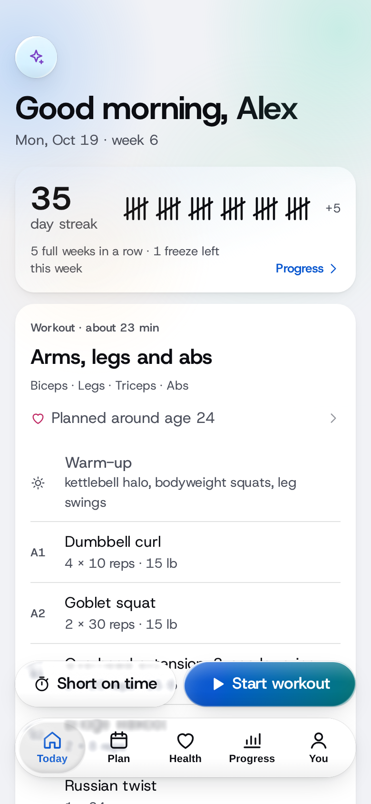
  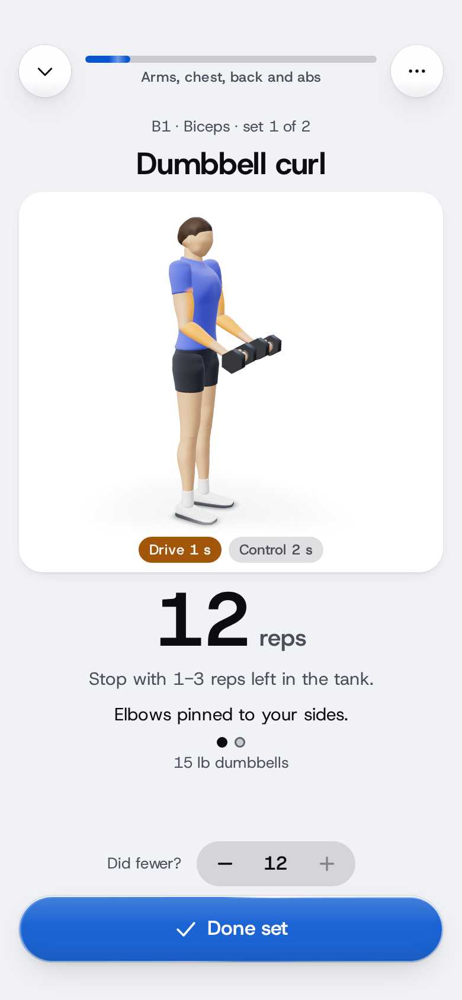
  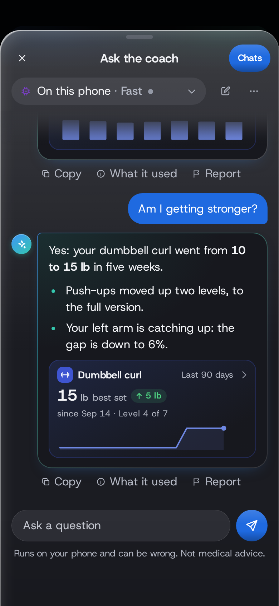
  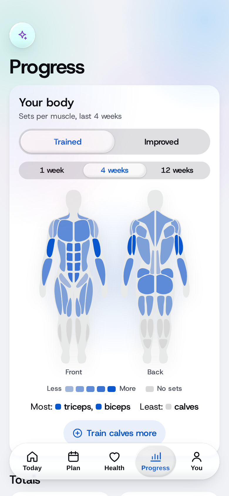

Gradient Health plans a workout for each day of your week around your goals, the equipment you have and the time you've got. A 3D figure shows you every move. After each exercise it asks one question, and your answer, with how you slept and recovered, decides what you do next time. Track your food and your health too, or only the parts you want.

| | |
|---|---|
| **[Today](#today)** | Today's workout, with what the coach changed and why |
| **[Plan](#plan)** | Your week at a glance, why it's built that way, and an AI check you approve |
| **[Your plans](#your-plans)** | Build your own plan, or ask the coach for one, and share it with a QR code |
| **[Workouts](#workouts)** | A 3D figure for every move, one question after each exercise, and a plan that fits your age and your body |
| **[Moves](#moves)** | 282 exercises, at home or at the gym, seated or standing, each with a how-to |
| **[Badges](#badges)** | 64 to earn, from your first workout to a 100-day streak, to share with friends and family |
| **[Activities](#activities)** | Runs, walks, hikes and rides with GPS, a map, and your watch's heart rate |
| **[Food](#food)** | Calories and macros, or just protein, or nothing |
| **[Health](#health)** | Sleep, steps, heart rate, weight and more at a glance, with the history behind each number |
| **[Progress](#progress)** | A body map of what you've trained and what's improved |
| **[The coach](#the-coach)** | Ask it anything about your numbers, and tailor your plan by just saying what you want |
| **[You](#you)** | Your profile, badges, plans and Settings in one place |

## Today

Open the app and today's workout is waiting: what it trains, how long it takes, and each exercise with its sets, reps and weight. If the coach changed anything, the card says what and why ("1 set off each exercise: 5 h 10 m of sleep"). Short on time? One tap turns the session into a real 12 to 15 minute version. Your streak, your steps and your food for the day sit alongside.

## Plan

A strip of seven days shows the whole week: done, today, workouts to come, light days and rest. Tap any day to see it, from the exercises in a workout (each shown by the 3D figure) to what you did on one you've finished. Move a workout to a free day with a tap, or press and drag it there, and Undo if you change your mind. Swipe for next week. Below the week: how many sets each muscle has had against its target, what's coming up, and the settings that shape your plan.

Miss a day and the rest of the week moves forward instead of doubling up. Every fifth week is a lighter deload week, and it comes sooner if you're run down.

**Why this plan.** The planner weighs every way to share your muscle groups over your days, often thousands of them, and picks the week that fits your goals, your time and your recovery best. Why this plan shows what it compared, how your week scores, and how full body, upper and lower, or push, pull and legs would do instead. Workouts fill the time you set (an hour means an hour, and never more), and every muscle gets its weekly minimum; on the shortest days, muscle groups take turns over two weeks.

**Check my plan with AI.** The on-device coach or Claude looks your plan over and suggests up to three changes. Each one is checked first against your equipment, your joints and your time, and shows what it changes ("+2 back sets a week"). Pick the ones you want, and Undo puts it back. With Claude on, the weekly report brings plan ideas too.

  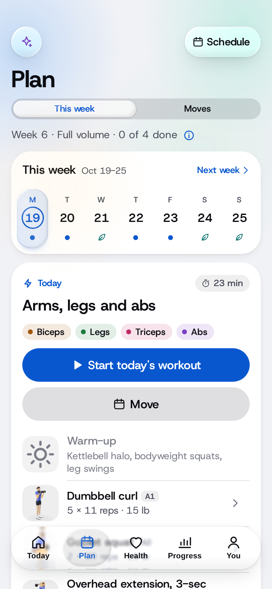
  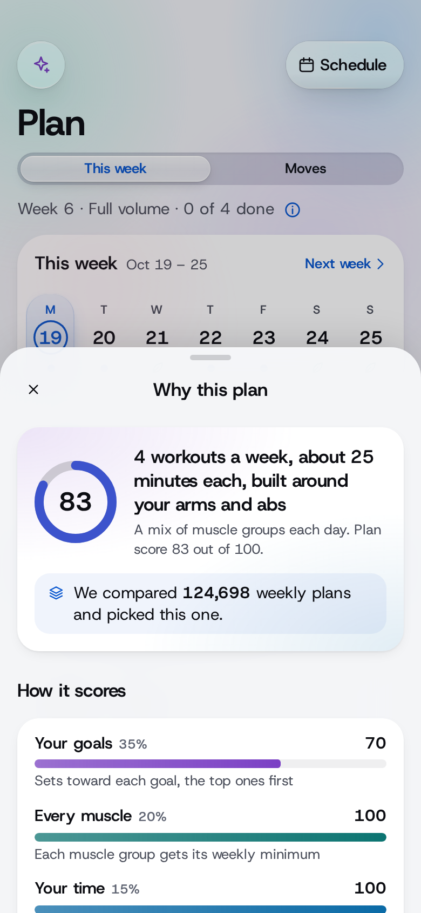
  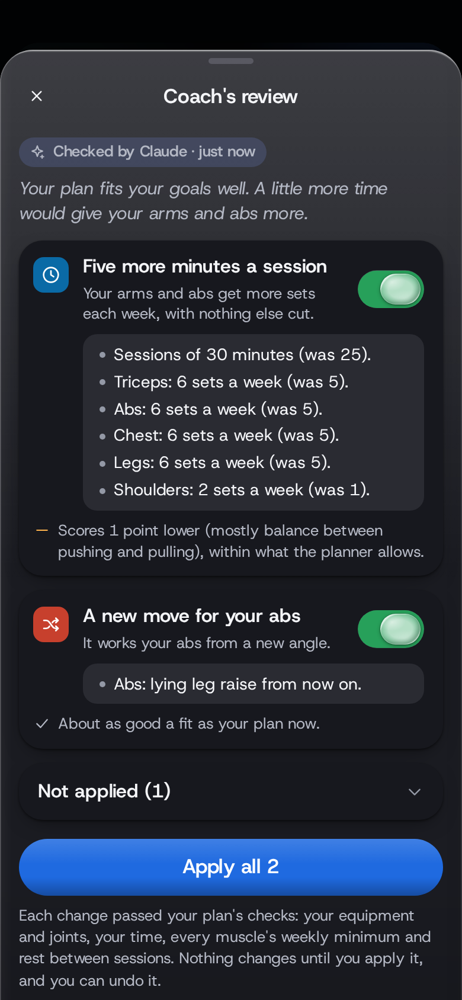

## Your plans

Rather pick the exercises yourself? Build a plan like a playlist: add moves from the library (each shown by the 3D figure, filtered by muscle and by what you have), set the sets and reps with a tap, drag them into order and pick your days. Or tell the coach "3 days, 30 minutes, bigger arms, easy on my knees" and it builds one from what it already knows about you, then shows it to you before anything changes. Either way it runs like the coach's plan, with the same lighter weeks and easier days, and each exercise moves on from the reps and weights you log. Back to the coach's plan is one tap.

Share a plan with a QR code or a link. Your friend scans it or taps it, sees the whole plan and saves it. If it needs something they don't have, like a barbell, or a move that's hard on a joint they're careful with, the app swaps in the closest exercise they can do and says why.

  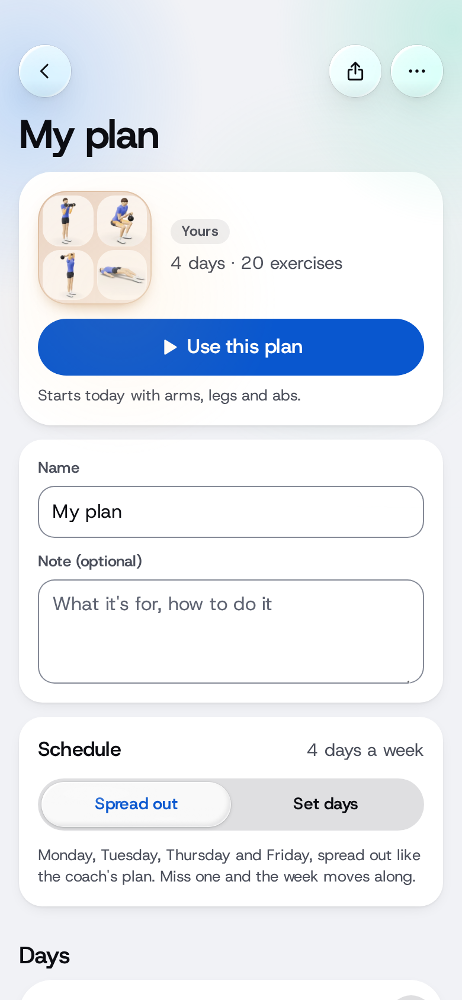
  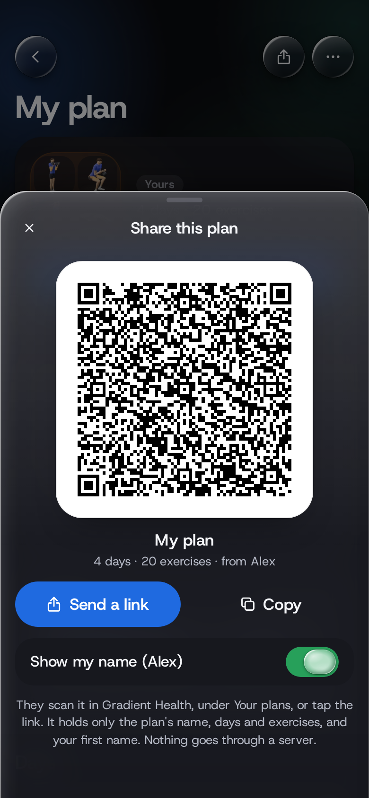

## Workouts

**It fits your life.** Set-up takes six short steps and ends on your plan, with your first workout a tap away. Tell it what you want (visible abs, bigger arms, stronger legs, just showing up more), how many days you can train and for how long. Your top goals are trained most and done first, while you're fresh. Ten minutes or an hour, two days a week or six, a pair of dumbbells or nothing at all.

**A 3D figure shows every move,** at the right tempo, with the working muscles lit. Drag it to see it from any side. A strip under it shows how long to take on each half of a rep, and a countdown haptic tells you when a timer's about to end.

**One question makes it smarter.** After each exercise it asks how many more reps you could have done. Answer 0 and it holds you steady, 1 or 2 and it adds a little, 3 or more and it moves you up: more reps first, then more weight, then a harder version of the move. When you've outgrown your heaviest dumbbell, it tells you what to get next.

**Easier on the days you need it.** Slept under five hours? Resting heart rate well above your normal, or HRV well below it? Sore and low on energy? It takes a set off each exercise that day. Went for a long run yesterday? Your legs get a lighter day.

**At home or at the gym.** Tell it what your gym has (barbells, a rack, cables, machines, a full dumbbell rack) and gym days use it, each exercise with a starting weight on the light side. Hit the top of your reps with some left in the tank and the weight goes up next time. Train at both? Switch today between home and gym with one tap, and each keeps its own progress.

**It fits your body.** Your age shapes the plan: a little more variety and faster progress under 30, a longer, gentler warm-up, balance practice and one fast-up set a week from 50, and from 65 balance every session, supported moves like sit to stand, and practice getting down to the floor and up. Tell it about a health condition and the plan works around it: no weight on painful hands with rheumatoid arthritis (and a flare-day switch that turns the day into gentle range of motion), no spine bending with osteoporosis, back-friendly core work with back pain, no head-down positions with high blood pressure, supported balance work with balance problems, and every move seated for a wheelchair user. Your conditions stay on your phone and are never sent to Claude.

**Catch up a weaker side.** If one arm or leg is weaker, it goes first, the other side never does more reps, and it gets one extra set. A quick left vs right test every two weeks shows the gap closing.

Started by mistake? Go back and cancel the workout: nothing from it is saved or counts against your streak.

  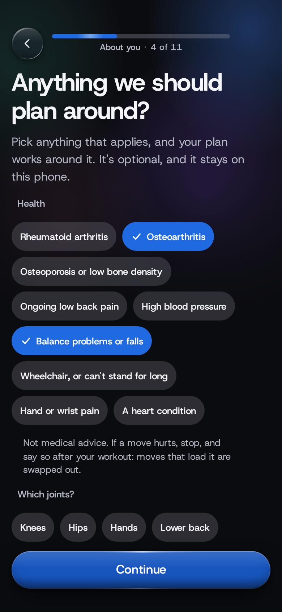
  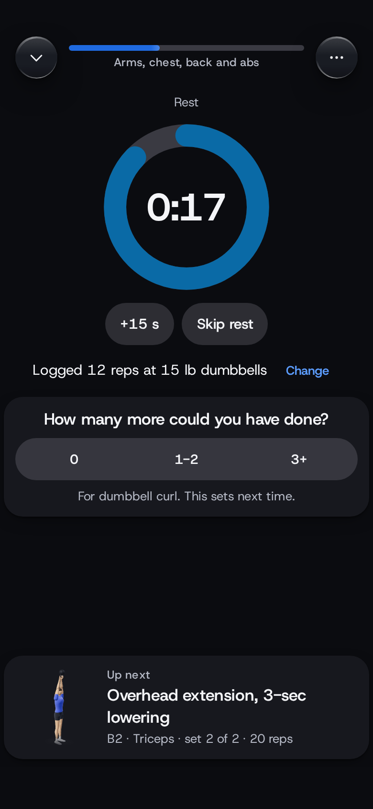
  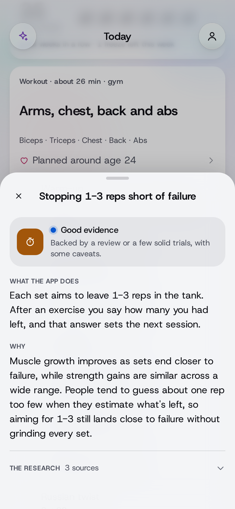
  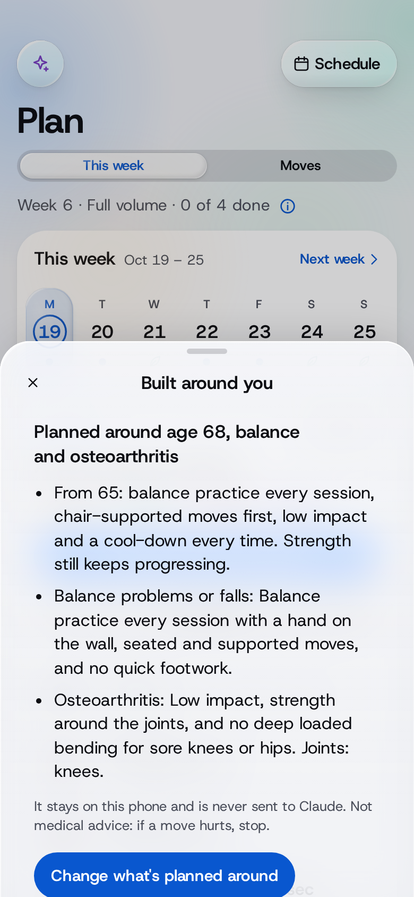

## Moves

282 exercises in Plan's Moves section, each with a how-to: the figure, the cues that matter and the muscles it works. Home moves climb in ladders from easy to hard (push-ups from the wall to the floor and beyond), so there's always a next step, even with no equipment: a chair, a wall and a towel give you rows, overhead presses, calf raises and hamstring curls. Warm-ups follow the day's muscles, and with the mobility goal a short cool-down stretches what you trained. 71 of them are seated, supported, balance and floor-friendly moves for the plans that need them. Don't like a move? Swap it, or tell the coach to leave it out.

## Activities

Going for a run with the dog? Start a run, walk, hike or ride from Today or Health. The app records your route with GPS and counts your steps, even with the screen off, and a notification shows your time and distance with Pause and Finish. Afterwards you get a summary: the map of where you went, distance, pace and splits, elevation, steps, and heart rate and calories from your watch through Health Connect. Save it to Health Connect with its route. Your history and personal records (fastest mile, longest ride and more) live next to it.

  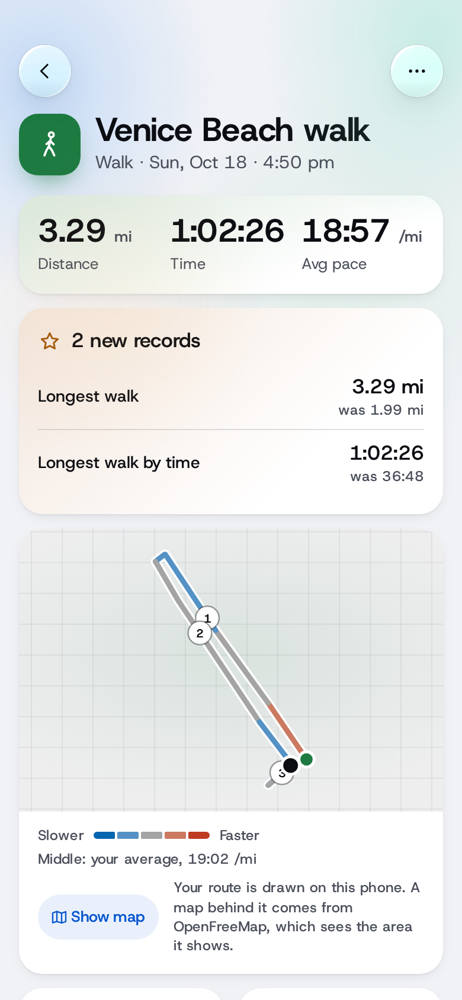
  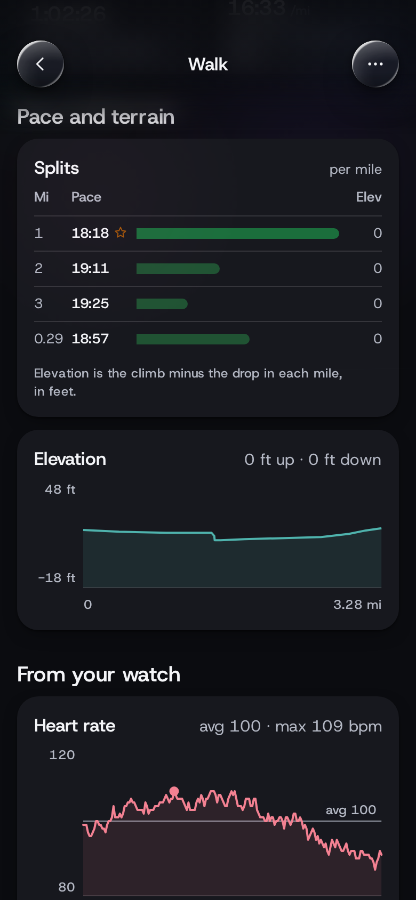

## Food

Turn on calorie tracking and you get a daily target worked out from your size, your steps and your goal, which tunes itself once you've logged for a couple of weeks and weighed in. Log from a built-in list of common foods, your own foods from a label, saved meals or a quick number. Online search and barcode scanning (from Open Food Facts) are there if you switch them on. Prefer just a protein goal? That's one setting. Only want food and health, no workouts? That works too.

## Health

Connect Health Connect and your sleep, steps, weight, heart rate, HRV, active calories, distance and workouts from other apps come in on their own. The top of the Health tab says how your week is going in a line, with your key numbers next to your usual and one thing to focus on next.

Tap any number (weight, resting heart rate, sleep, steps) to see its history over a week, a month, three months or a year, with its average, low and high, where each day's value came from, and a plain explanation of what it means. Add a value or change one: your entry takes over from Health Connect's for that day, and you can remove it again.

It syncs every time you open the app, and every 15 minutes in the background if you allow it, so your history has no gaps on days you don't open the app. It can save your workouts, activities and meals back to Health Connect. Insights only show up when there's enough data to back them: a week of short sleep, a resting heart rate creeping up, a weight trend moving faster than it should.

  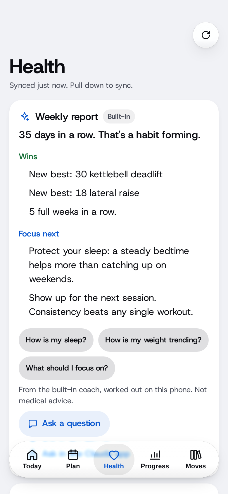
  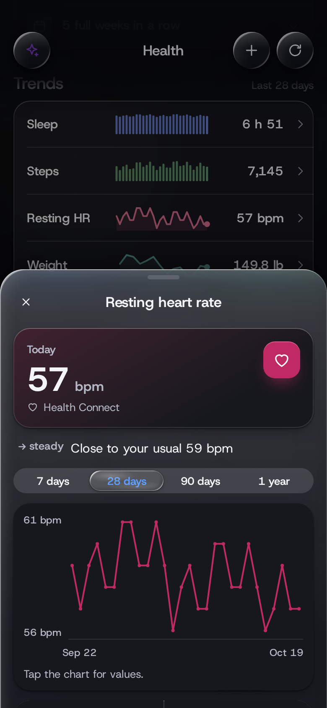
  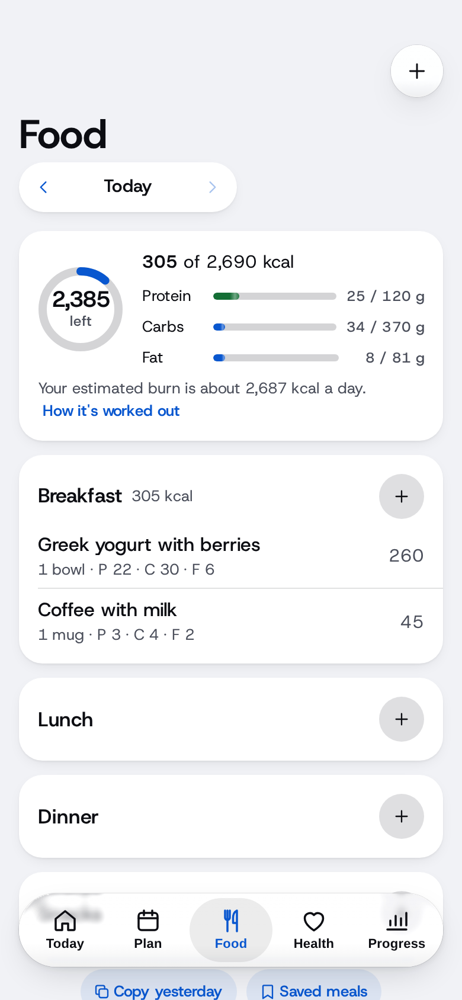

## Progress

A body map, front and back, lights up the muscles you've trained most over the last week, month or three months. Switch it to Improved and it shows where you've got stronger instead. Tap a muscle to see its sets week by week, the exercises that trained it and how far you've come ("Bench press 60 → 72.5 kg", "Push-ups level 3 → 5"). If one's falling behind, a tap asks the coach to train it more.

Strength charts, your left and right sides, levels, and the moments worth remembering are all there too.

## Badges

64 badges for the things worth celebrating: your first workout, streaks from 3 days to 100, every muscle trained in a week, your first pull-up, a 5K, a month of protein goals, and a few secret ones. Once earned they're yours for good, with the date. Share one as a picture with friends and family: it shows the badge and what it took, and your name only if you choose.

  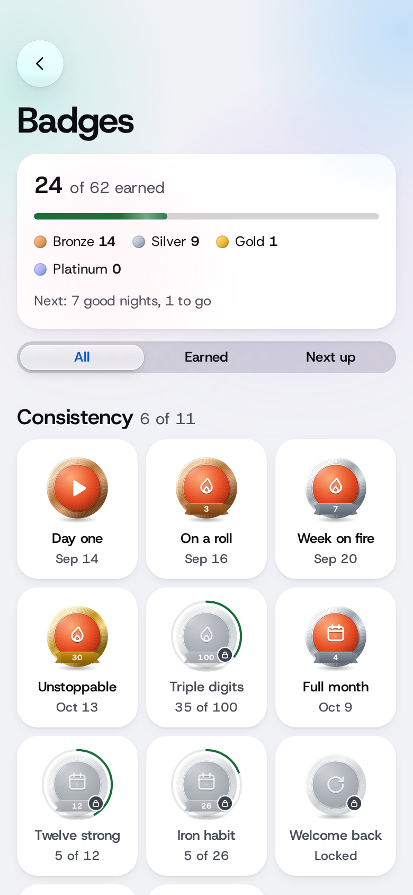
  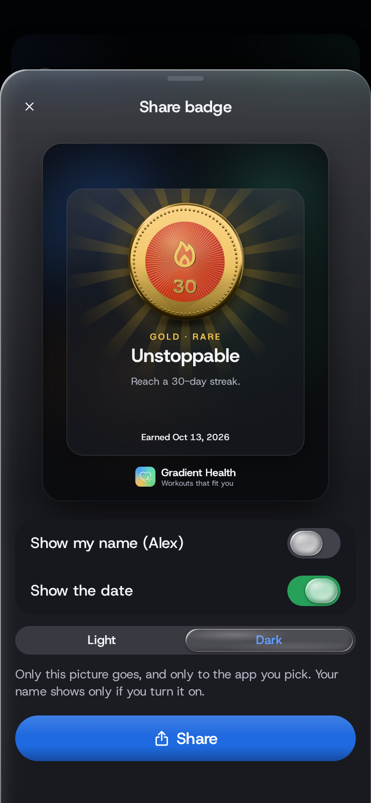

## You

Your profile, your badges, your plans, your set-up answers and Settings live in the You tab. Settings has a search, so units or haptics are a word away.

  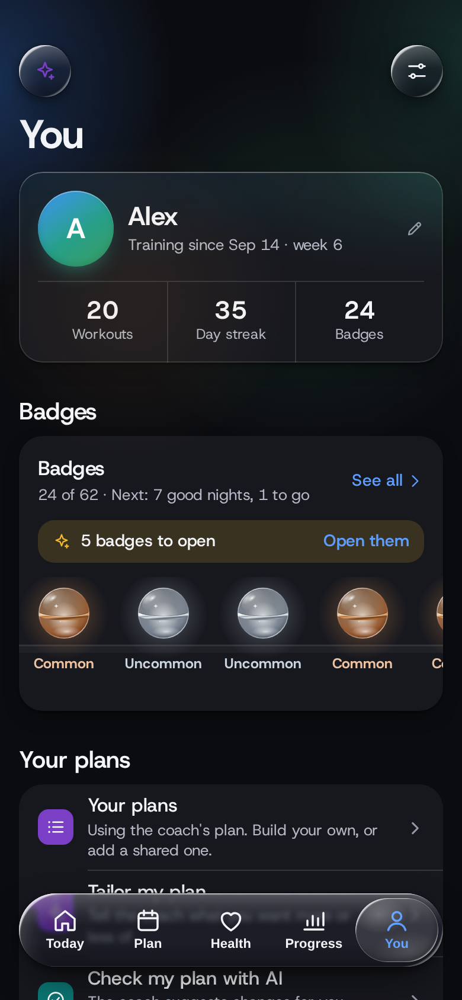

## The coach

**It shows its work.** The coach never changes your plan quietly. Today's card says what changed and why, and the Coach page lists its suggestions (you apply them or not), what it's keeping an eye on and every change it made lately.

**Ask it anything about your numbers.** Tap the sparkle at the top left of any tab. An AI model runs on your phone (Qwen3.5, in three sizes), so it works offline and nothing you ask leaves the phone. It doesn't guess from raw numbers: each question goes in with what the app has already worked out from your data and the research behind it, and "What it used" under each answer shows exactly that. Suggested questions come from your own data. Answers keep coming if you close the chat, and the button tells you when one's ready.

**Tailor your plan by saying what you want.** "More legs, my knees hurt, 20 minutes", or "train my calves more". The coach shows you the changes first (legs trained more often, easy on the knees, shorter workouts) and nothing changes until you apply it. Undo is always there.

**Or use Claude.** Add your own Anthropic API key and Claude answers in the app, writes your weekly report and reads your Tailor requests. Or tap Ask in the Claude app and your question plus a summary of your data (no name, no dates) opens there.

  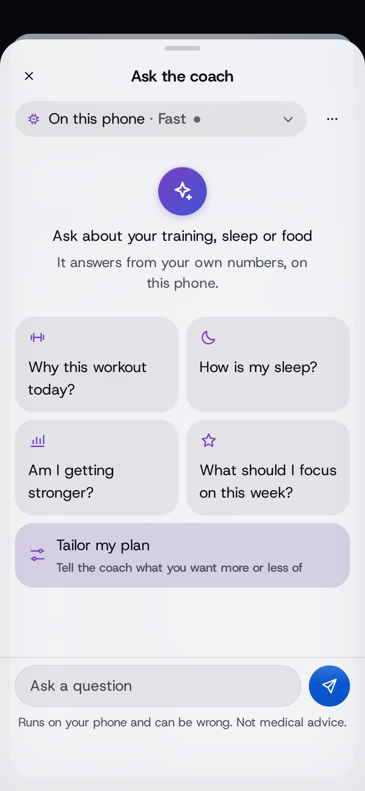
  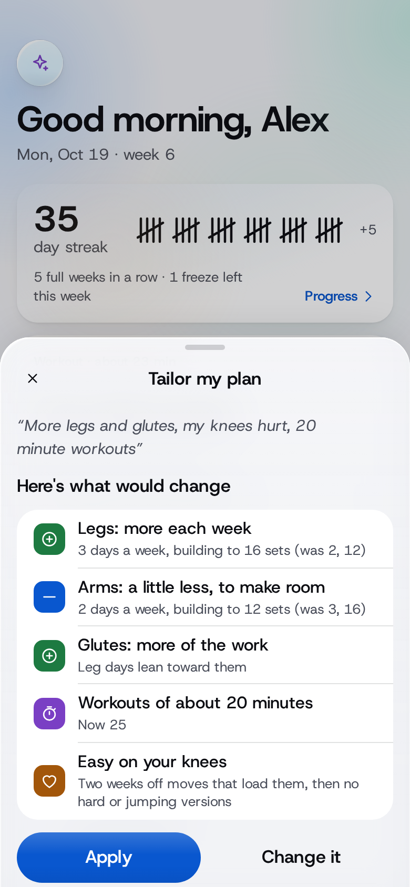
  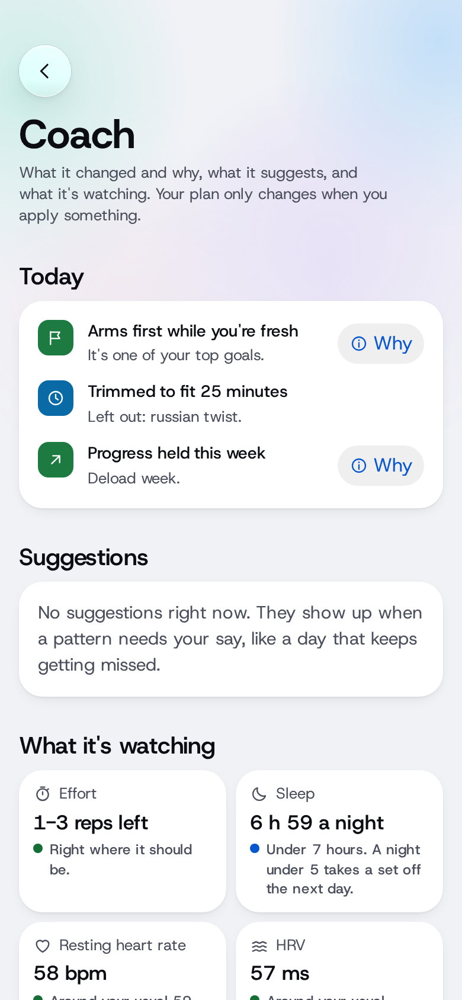

### How the on-device AI runs

The app runs the model with llama.cpp built for your phone's processor, on its fast cores, in a separate process so a problem there can't take the app down. Phones it can't run on use a slower copy that runs inside the app. The model reads your data summary once and keeps it, so each new question starts answering quickly. Settings has a check that shows which engine ran, how long the model took to start and how fast it writes.

Small models can slip, so the app checks every answer. A yes-or-no question starts from the app's own yes or no, worked out from your numbers, and a question built on something that isn't so ("Why is today lighter?" on a full day) starts from the app's correction. A line with a number that isn't in your data is left out, and if too little is left, you get the app's own answer instead, with a note saying so.

Pick a size in the chat or in Settings: Fast (0.8B, 533 MB) starts answering soonest, Balanced (2B, 1.28 GB, 6 GB of memory or more) reads your numbers noticeably better and is the one suggested on phones with 8 GB or more, and Best answers (4B, 2.74 GB) needs 12 GB. The download is one-off, checked, resumable, and can wait for Wi-Fi.

## Made to feel good

Glass bars, switches and buttons over soft colours that drift slowly behind each page, and controls that answer every tap, even a slightly wobbly one. Pages slide away as the next one comes in, and cards glide when something is added or removed. Sheets slide up from the bottom and follow your finger, from a quick glance up to full height. Haptics have 31 distinct feels (a tick for each tab, a bump at the end of a stepper, a timer counting down, a finished set, a new best, a badge) in Light, Medium or Strong, and you can feel each one in Settings. 3D figures appear right away, with a picture of the move until it starts. Light and dark themes, bigger text, reduced motion and increased contrast are all respected.

## Built on research, and honest about it

Every rule Gradient Health follows, from how many sets you do to how long you rest, is listed in the app under training, recovery, food and habits, each with a one-line summary, the studies behind it and a plain rating of how strong the evidence is. Where the research is thin, it says so.

  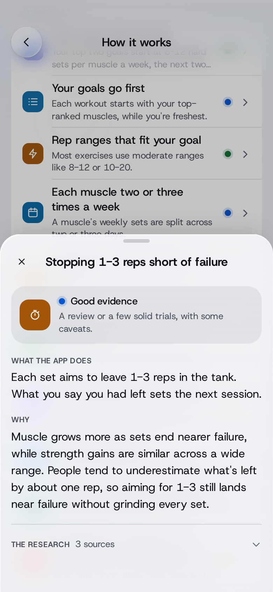
  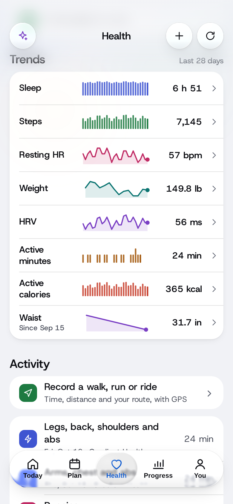

## Private by design

No account, no ads and no analytics. Everything stays on your phone. The only things that ever leave it are ones you choose: a summary you send to Claude (the app shows you exactly what it says first), the words or barcode of a food you look up online, the one-time download of the on-device model, a workout plan you share with someone, and street map pieces for an activity's area when you tap Show streets. The [privacy policy](docs/PRIVACY.md) lists every piece of data and where it goes.

## Get it

Download `gradient-health.apk` from the [latest release](../../releases/latest) and open it on your phone. You may need to allow installs from your browser or file manager. Updates install over the old version and keep your data.

Builds are signed with the app's release key, the one the Play Store and APKPure versions use. A build signed with the earlier test key won't update to one of these: copy your data first (Settings, Copy my data), uninstall, install the new build, then use Settings, Restore from a copy.

A genuine download's signing certificate has the SHA-256 `f32f5e8302cb9ec6f470254af7f9c894b6ac105a9f173988edf5ed536dc3f55f`. `apksigner verify --print-certs gradient-health.apk` shows it.

Gradient Health runs on Android 8.0 and newer. Health Connect needs Android 14 or newer; on older phones you can log sleep and weight by hand. The on-device AI's fast engine needs a 64-bit phone, which is nearly all of them since 2017.

Gradient Health isn't medical advice. If you have a condition or an injury, check with a doctor before you start.

---

Building it yourself, running the tests or curious how it's put together? See [docs/DEVELOPING.md](docs/DEVELOPING.md).
