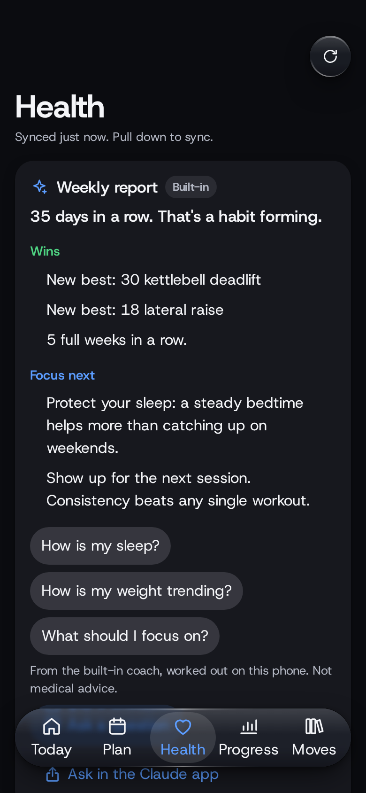
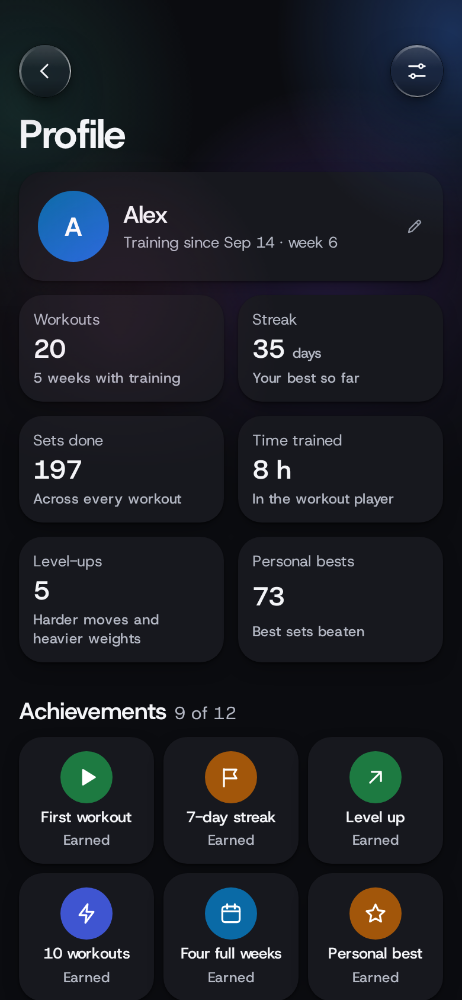

# Gradient Health

**Home workouts that adjust to you, every day.**

Gradient Health plans a workout for each day of your week around your goals, the equipment you own and the time you have. Every move comes with an animated diagram. After each exercise it asks one question, and your answer, together with how you slept and recovered, decides what you do next time.

  
  
  
  

## A plan that fits your life

Tell Gradient Health what you want (visible abs, bigger arms, stronger legs, just showing up more), how many days you can train and for how long. It builds a week from that, with your top goals trained most. Ten minutes or an hour, two days a week or six, a pair of dumbbells or nothing at all: the plan works with what you have.

Miss a day and the rest of the week moves forward instead of doubling up. Short on time? One tap turns today's session into a real 12 to 15 minute version.

## One question makes it smarter

After each exercise you get asked how many more reps you could have done. That's it. Answer 0 and it holds you steady, 1 or 2 and it adds a little, 3 or more and it moves you up: more reps first, then a heavier weight, then a harder version of the move. When you've outgrown your heaviest dumbbell, it tells you what to buy next.

  
  
  

## Easier on the days you need it

Slept under five hours? Resting heart rate well above your normal, or HRV well below it? Sore and low on energy? Gradient Health takes a set off each exercise that day, so you keep the habit without digging a hole. Went for a long run yesterday? Your legs get a lighter day. Every fifth week is a lighter deload week, and it comes sooner if you're run down.

## Your health in one place

Connect Health Connect and your sleep, steps, weight, resting heart rate, HRV and workouts from other apps flow in on their own. Gradient Health syncs every time you open it and every 15 minutes while it's open, and you can pull down to sync right away. It can also save your Gradient Health workouts back to Health Connect so your other apps see them.

You get trends over 7, 28 and 90 days, and insights that only show up when there's enough data to back them: a week of short sleep, a resting heart rate creeping up, a weight trend moving faster than it should.

## A coach that knows your numbers

The built-in coach writes you a weekly report and answers questions about your sleep, steps, weight, protein, training and recovery, straight from your data, on your phone, with no internet needed. Want a real conversation? Tap Ask in the Claude app and your question, plus a summary of your data without your name or any dates, opens in Claude, answered with your own Claude plan. Or add an Anthropic API key and Claude writes the weekly report too.

## Catch up a weaker side

If one arm or leg is weaker, it goes first, the other side never does more reps, and it gets one extra set. A quick left vs right test every two weeks shows the gap closing, and the extra set switches off once it's under 10%.

## Built on research, and honest about it

Every rule Gradient Health follows, from how many sets you do to how long you rest, is listed in the app with the studies behind it and a plain rating of how strong that evidence is. Where the research is thin, it says so.

  
  

## Private by design

No account, no ads and no analytics. Everything stays on your phone. The only thing that ever leaves it is a summary you choose to send to Claude, and the app shows you exactly what that summary says first.

## Get it

Download `gradient-health.apk` from the [latest release](../../releases/latest) and open it on your phone. You may need to allow installs from your browser or file manager. Updates install over the old version and keep your data.

Gradient Health runs on Android 8.0 and newer. Health Connect needs Android 14 or newer; on older phones you can log sleep and weight by hand.

Gradient Health isn't medical advice. If you have a condition or an injury, check with a doctor before you start.

---

Building it yourself, running the tests or curious how it's put together? See [docs/DEVELOPING.md](docs/DEVELOPING.md).
