

<h1 align="center">Gradient Health</h1>

<b>Workouts that adjust to you, at home or at the gym.</b> 
A training plan, a food log, your health data and a coach that runs on your phone, in one private app.

  <a href="../../releases/latest"><b>Download the latest APK</b></a> ·
  Android 8.0+ ·
  No account, no ads, no analytics

  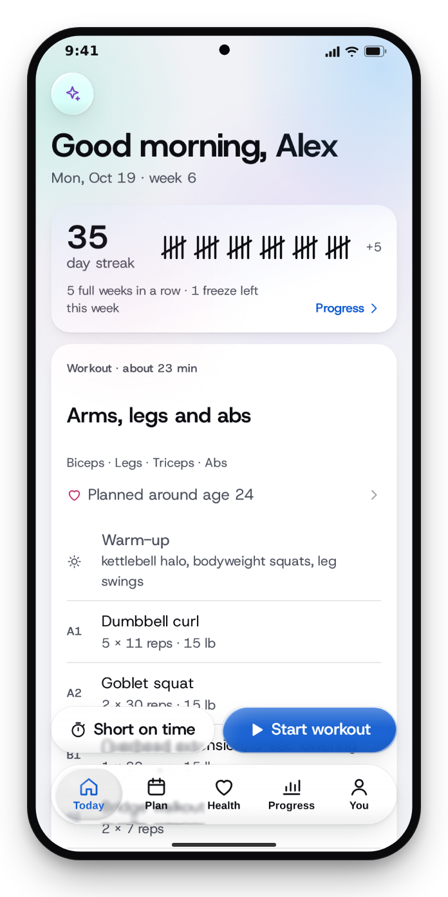
  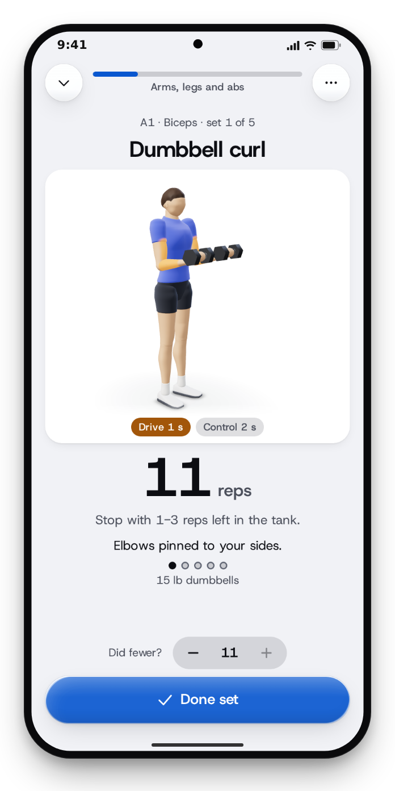
  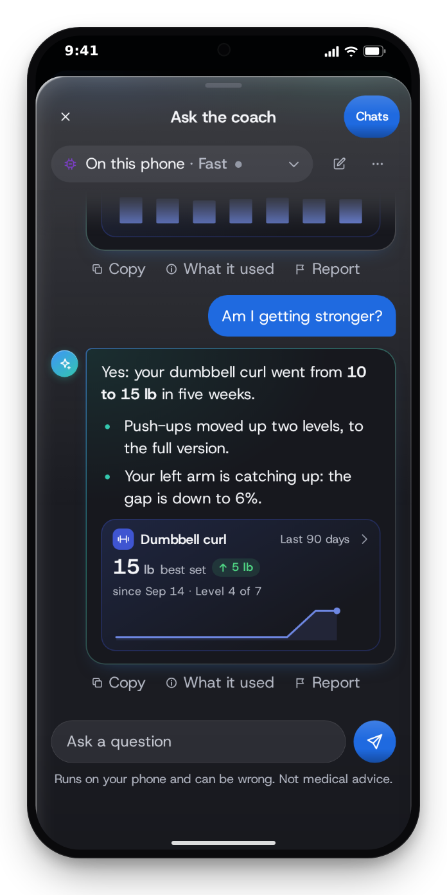
  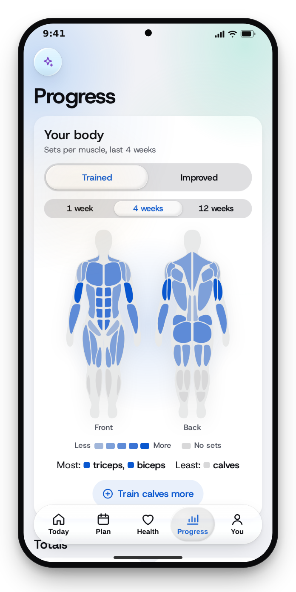

Gradient Health plans each day's workout around your goals, your equipment and your time. A 3D figure shows every move. After each exercise it asks how many more reps you could have done, and that answer, with your sleep and recovery, sets your next session. Food and health tracking are there if you want them.

## What's inside

| | |
|---|---|
| **[Today](#today)** | Today's workout, and what the coach changed and why |
| **[Plan](#plan)** | Your week, why it's built that way, and an AI check you approve |
| **[Your plans](#your-plans)** | Build your own or ask the coach for one, and share it with a QR code |
| **[Workouts](#workouts)** | A 3D figure for every move, one question per exercise, a plan that fits your body |
| **[Moves](#moves)** | 282 exercises for home or the gym, each with a how-to |
| **[Activities](#activities)** | Runs, walks, hikes and rides with GPS, auto-pause and spoken splits |
| **[Food](#food)** | Calories and macros, just protein, or nothing |
| **[Health](#health)** | Sleep, steps, heart rate, weight and more, with each number's history |
| **[Progress](#progress)** | A body map of what you've trained and what's improved |
| **[Badges](#badges)** | 64 3D medals to earn, open, spin and share |
| **[Reminders](#reminders)** | At most one nudge a day, never at night |
| **[You](#you)** | Your profile, badges, plans and Settings |
| **[The coach](#the-coach)** | Ask about your numbers, or change your plan by saying what you want |

Also: [the feel](#made-to-feel-good), [the research](#built-on-research), [privacy](#privacy), [getting it](#get-it) and [credits](#credits).

## Today

Today's workout is waiting when you open the app: what it trains, how long it takes, and each exercise's sets, reps and weight.

- **What changed, and why.** The card says when the coach changes something ("1 set off each exercise: 5 h 10 m of sleep").
- **Short on time?** One tap makes it a 12 to 15 minute version.
- Your streak, steps and food sit alongside.

## Plan

Seven days in a strip: done, today, workouts to come, light days and rest.

- **Tap a day** to see its exercises, or what you did.
- **Move a workout** to a free day with a tap or a drag, with Undo. Swipe for next week.
- **Below the week:** each muscle's sets against its target, what's next, and your plan's settings.
- **Miss a day** and the week moves forward instead of doubling up. Every fifth week is lighter, and comes sooner if you're run down.

### Why this plan

The planner weighs every way to split your muscle groups across your days, often thousands, and picks the best fit for your goals, time and recovery. Why this plan shows what it compared, how your week scores, and how full body, upper and lower, or push, pull and legs would do.

Workouts fill the time you set and never run over, and every muscle gets its weekly minimum. On the shortest days, muscle groups take turns over two weeks.

### Check my plan with AI

The on-device coach or Claude suggests up to three changes. Each is checked first against your equipment, joints and time, and shows what it changes ("+2 back sets a week"). Pick the ones you want, and Undo puts it back. With Claude on, the weekly report brings plan ideas too.

  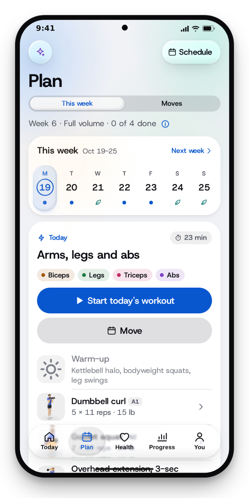
  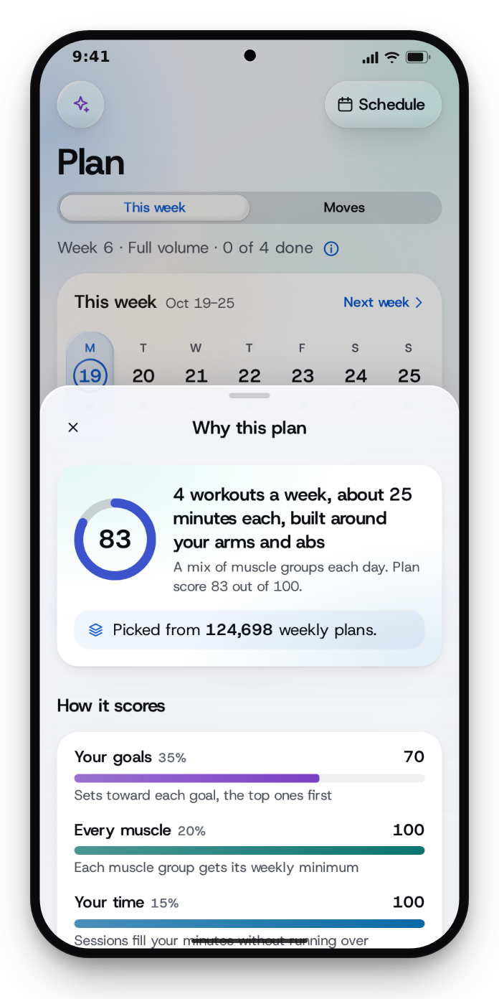
  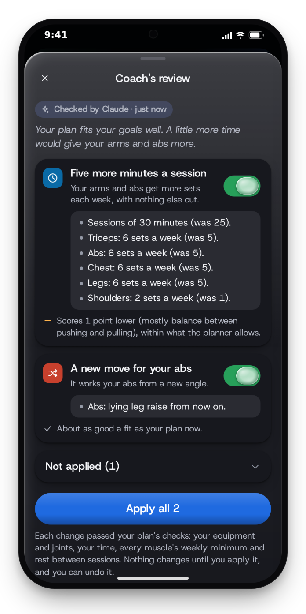

## Your plans

Two ways to make your own:

- **Build it like a playlist.** Add moves from the library, filtered by muscle and equipment, set the sets and reps, drag them into order and pick your days.
- **Or ask.** "3 days, 30 minutes, bigger arms, easy on my knees." The coach builds it from what it knows about you and shows it before anything changes.

It runs like the coach's plan, with the same lighter weeks, and each exercise progresses from what you log. Going back to the coach's plan is one tap.

**Share a plan** with a QR code or a link. If your friend lacks the equipment, or a move is hard on a joint they protect, the app swaps in the closest move they can do and says why.

  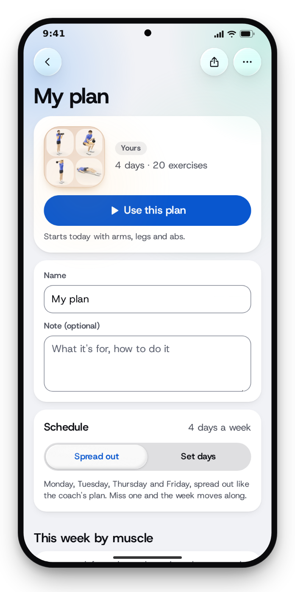
  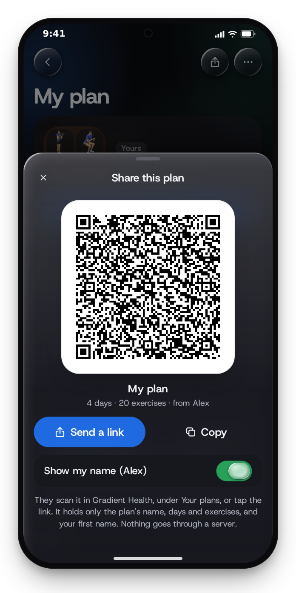

## Workouts

**Set-up is six short steps** and ends on your plan, with your first workout a tap away. Say what you want (visible abs, bigger arms, stronger legs, or just showing up), how many days and how long. Your top goals get trained most, and first. Ten minutes to an hour, two to six days, with dumbbells or nothing.

**A 3D figure shows every move** at the right tempo, with the working muscles lit. Drag it to turn it. A strip shows how long each half of a rep takes, and a haptic counts down the end of a timer.

**One question after each exercise:** how many more reps could you have done?

| You answer | Next time |
|---|---|
| 0 | It holds you steady |
| 1 or 2 | It adds a little |
| 3 or more | It moves you up: more reps, then more weight, then a harder version |

When you outgrow your heaviest dumbbell, it says what to get next.

**Easier when you need it.** Under five hours of sleep, a resting heart rate well above normal, HRV well below it, or sore and tired: a set comes off each exercise that day. A long run yesterday means a lighter day for your legs.

**Home or gym.** Tell it what your gym has and gym days use it, starting light. Finish your reps with some left and the weight goes up next time. Train at both? Switch with one tap, and each keeps its own progress.

**It fits your body.** Your age shapes the plan:

- **Under 30:** more variety and faster progress.
- **50 and over:** a longer warm-up, balance practice and one fast-up set a week.
- **65 and over:** balance every session, supported moves like sit to stand, and practice getting up from the floor.

Health conditions change it too:

- **Rheumatoid arthritis:** no weight on painful hands, and a flare-day switch for gentle range of motion.
- **Osteoporosis:** no spine bending.
- **Back pain:** back-friendly core work.
- **High blood pressure:** no head-down positions.
- **Balance problems:** supported balance work.
- **Wheelchair users:** every move seated.

Your conditions stay on your phone and are never sent to Claude.

**Weaker side?** It goes first, the other side never does more reps, and it gets an extra set. A left and right test every two weeks tracks the gap.

**Started by mistake?** Cancel it. Nothing is saved, and your streak is safe.

  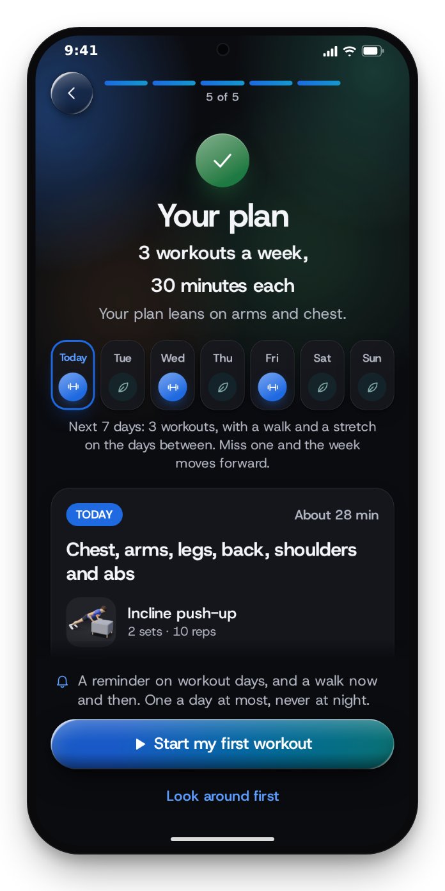
  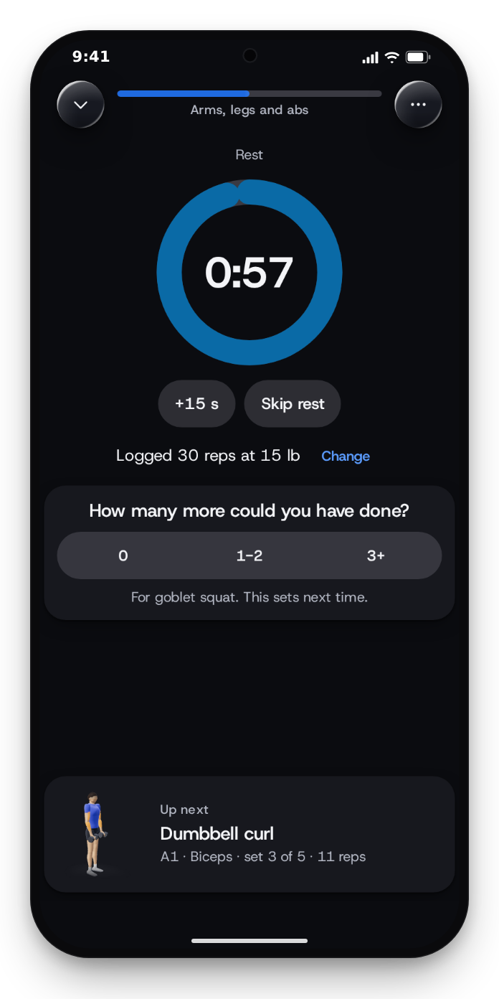
  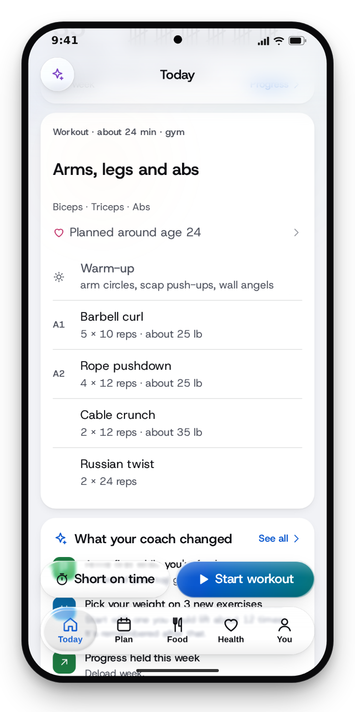
  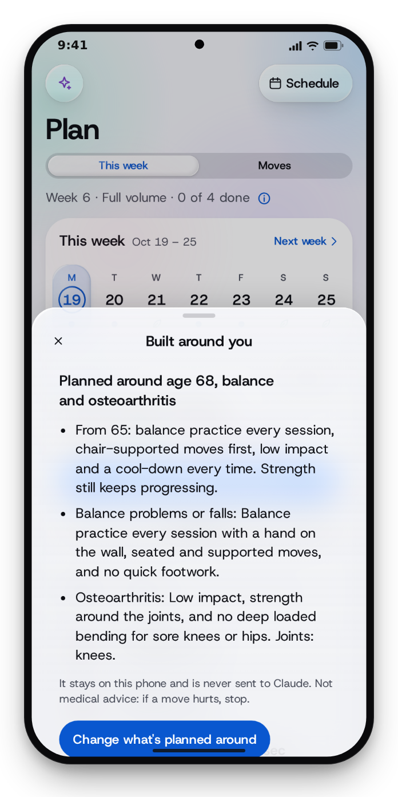

## Moves

282 exercises in Plan's Moves section, each with the figure, the cues that matter and the muscles it works.

- **Ladders from easy to hard,** so there's always a next step. With no equipment, a chair, a wall and a towel give you rows, overhead presses, calf raises and hamstring curls.
- **Warm-ups match the day's muscles,** and the mobility goal adds a cool-down.
- **71 seated, supported, balance and floor-friendly moves** for the plans that need them.
- **Don't like a move?** Swap it, or ask the coach to leave it out.

## Activities

Start a run, walk, hike or ride from Today or Health.

- **On the move:** GPS records your route and counts steps with the screen off, and a notification shows your time and distance with Pause and Finish. The live map follows you and shows the GPS accuracy, which way you're facing and the signal strength.
- **Auto-pause** stops the clock at a crossing and starts it as you go. It's on for runs and rides, and you can turn it on for walks and hikes.
- **Spoken splits** at each kilometre or mile, over your music, if you turn them on.
- **Steady numbers:** the pace is your pace now, the distance doesn't creep up while you stand still, and the route is smoothed.
- **Afterwards:** your route in pace colours on an OpenFreeMap map (move and zoom with two fingers), splits, elevation and steps, plus heart rate and calories from your watch through Health Connect. Maps you've seen open at once and work offline, and maps can be turned off.
- **Save it** to Health Connect with its route. Your history and records (fastest mile, longest ride and more) are kept with it.

  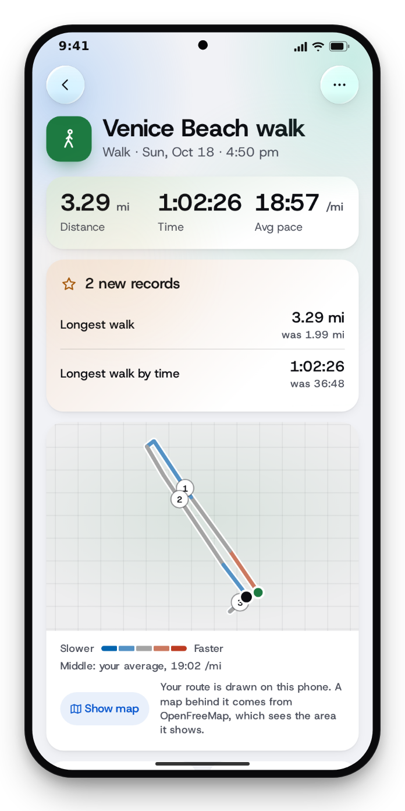
  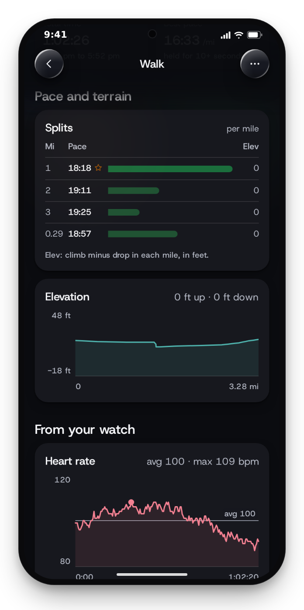

## Food

Turn on calorie tracking for a daily target from your size, steps and goal. It tunes itself once you've logged and weighed in for a couple of weeks.

- **Log your way:** common foods, your own foods from a label, saved meals or a quick number.
- **Online search and barcode scanning** (Open Food Facts), if you switch them on.
- **Just a protein goal?** One setting. Food and health with no workouts works too.

## Health

Connect Health Connect and your sleep, steps, weight, heart rate, HRV, active calories, distance and other apps' workouts come in by themselves. The top of the Health tab sums up your week: your main numbers against your usual, and one thing to work on.

- **Tap any number** for its history over a week, a month, three months or a year, with its average, low and high, each day's source, and what it means.
- **Fix a value.** Your entry replaces Health Connect's for that day, and you can remove it.
- **No gaps.** It syncs when you open the app, and every 15 minutes in the background if you allow it. It can save your workouts, activities and meals to Health Connect.
- **Insights only when the data backs them:** a week of short sleep, a resting heart rate creeping up, weight moving faster than it should.

  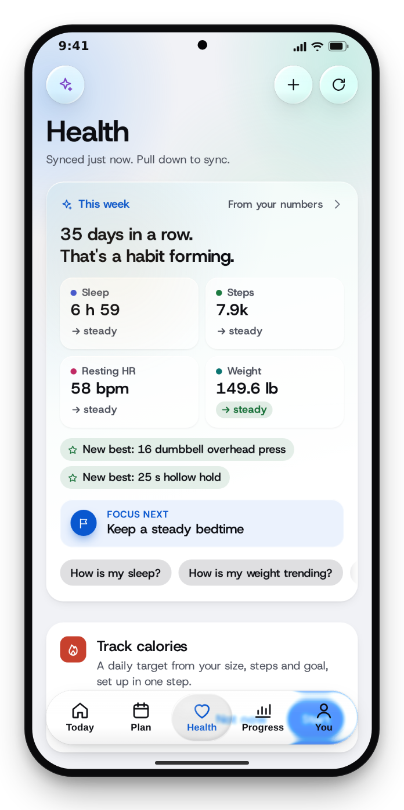
  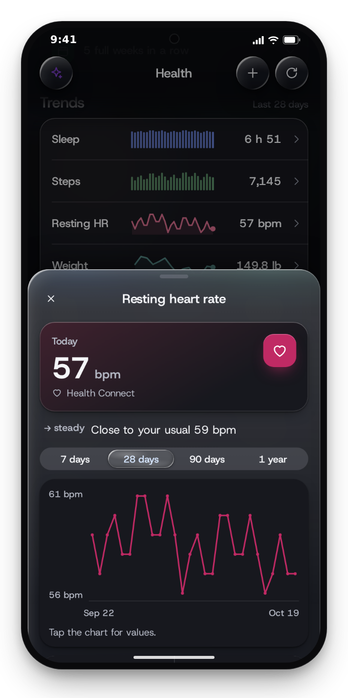
  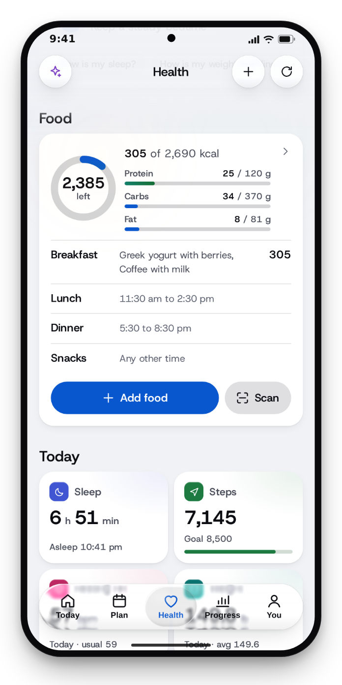

## Progress

A front and back body map lights up the muscles you trained most over the last week, month or three months. Switch to Improved to see where you got stronger.

- **Tap a muscle** for its sets week by week, the exercises that trained it and how far you've come ("Bench press 60 → 72.5 kg").
- **Falling behind?** One tap asks the coach to train it more.
- Strength charts, your left and right sides, levels and milestones are there too.

## Badges

64 badges: your first workout, streaks from 3 days to 100, every muscle in a week, your first pull-up, a 5K, a month of protein goals, and a few secret ones. Once earned, they're yours for good, with the date.

**Each badge is a 3D medal** in bronze, silver, gold or platinum, with an enamel face, and its name and date engraved on the back. Spin it with your finger, or tilt your phone and the light moves across it. Badges you haven't earned are blank medals that show your progress.

**New badges arrive sealed** in a glass capsule in the tier's colours, so you see how rare it is first. Three taps crack it open and the medal spins out, with a haptic at each tap. Earned several? Open them one at a time or all at once.

Your best medals stand on a shelf on You, rarest first, and Next up shows the next step in each series. Share one as a picture; your name is on it only if you choose.

  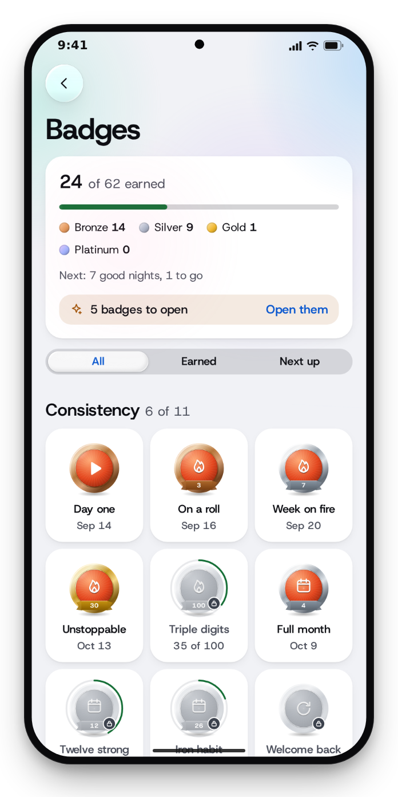
  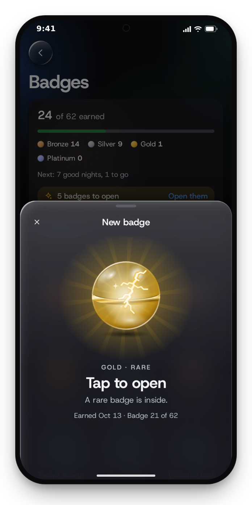
  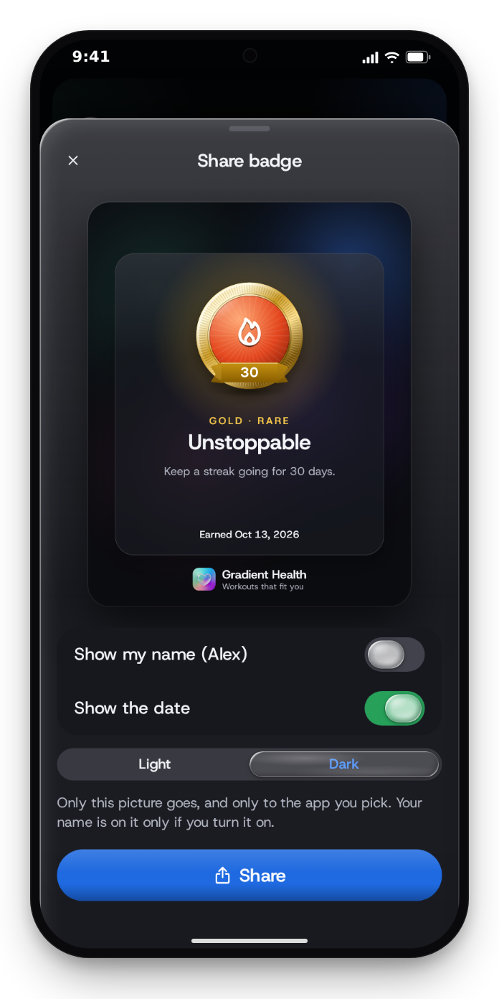

## Reminders

Reminders are on once you finish setting up (Android asks you first). Pick what you want in Settings:

- **Workout days:** what's on, a little before you usually train. Nothing on rest days, or once you've trained.
- **Walks and runs:** now and then on a rest day.
- **Badges:** one waiting to be opened.
- **Sleep:** good news after a great night.
- **Been away?** One note after a few days, then at most one a week, stopping after a few weeks.

At most one a day, never at night, and each kind can be turned off. They're worked out on your phone, and nothing is sent anywhere.

  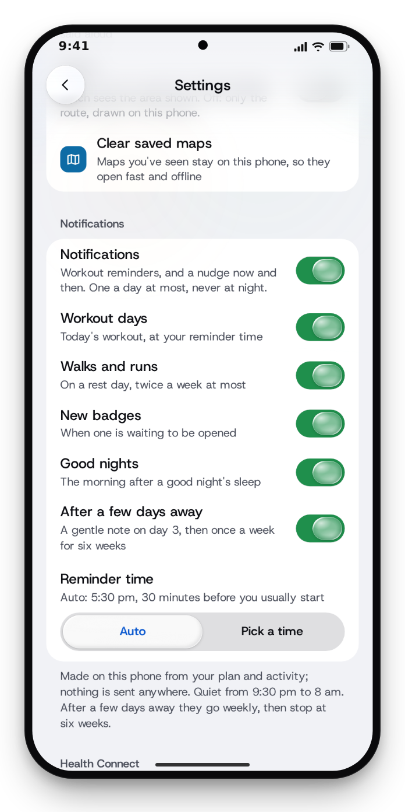

## You

Your profile, badges, plans, set-up answers and Settings. Settings has a search.

  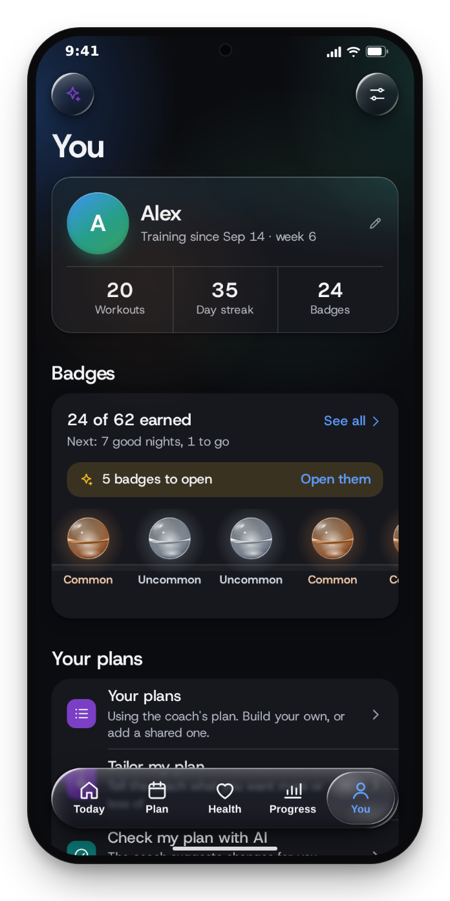

## The coach

**It shows its work.** The coach never changes your plan without saying so. Today's card says what changed and why, and the Coach page lists its suggestions (yours to apply), what it's watching and its recent changes.

**Ask about your numbers** with the sparkle at the top left of any tab.

- An AI model runs on your phone (Qwen3.5, in three sizes), so it works offline and nothing you ask leaves the phone.
- Each question goes in with what the app has already worked out from your data and the research, and "What it used" under each answer shows exactly that.
- **Answers are short and easy to scan:** the answer in a line with the number that matters in bold, a few points, a next step. Cards of your own data sit inside, like your sleep this week or how a lift has gone, drawn from the app's numbers, never the model's. Tap one to open it.
- **Your chats are kept.** Start a new one any time, or go back to an old one and carry on where you left off. They stay on your phone.
- Suggested questions come from your data. Answers keep coming if you close the chat.

**Change your plan by saying what you want:** "More legs, my knees hurt, 20 minutes." The coach shows the changes first, and nothing changes until you apply them. Undo is always there.

**Or use Claude** with your own Anthropic API key, for answers, the weekly report, and building, checking and improving plans. Or tap Ask in the Claude app to take your question there with a summary of your data (no name, no dates).

- **Pick the model and how much it thinks:** Fable 5.1, Opus 5.5, Sonnet 5.5, Haiku 5.5 or an older one, from no thinking to Max, with about what a question costs next to each.
- **Spending limits that hold.** A monthly budget gives each day an equal share of what's left, and you can add a daily limit or a most per request. A request that could go over a limit isn't sent, and Claude's page shows the cost by day, feature and model.
- **Lean requests.** Each feature sends only the part of your summary it needs, and a conversation is cached between questions, so answers cost less.

  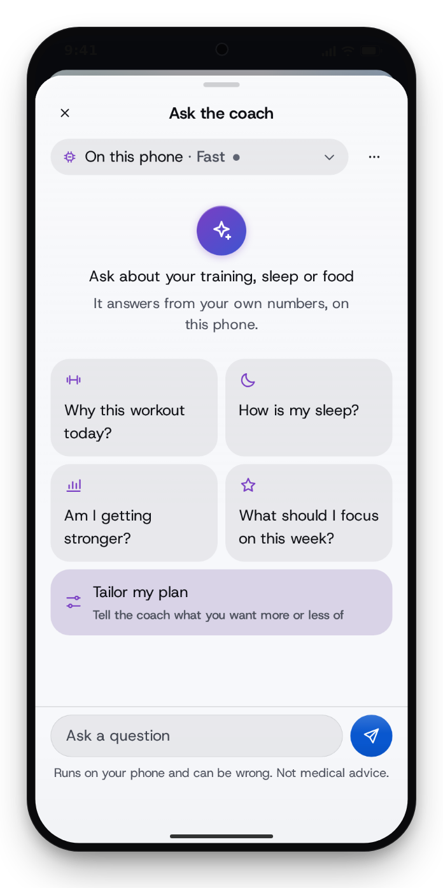
  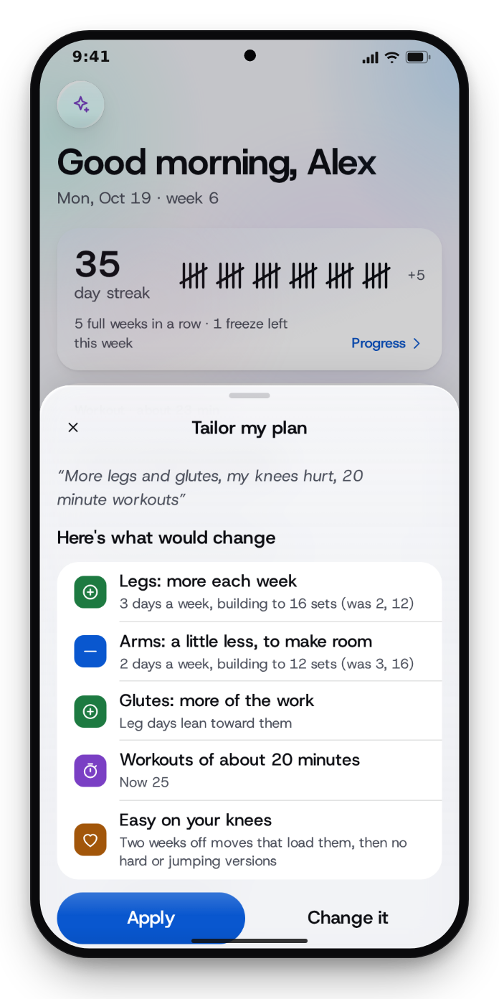
  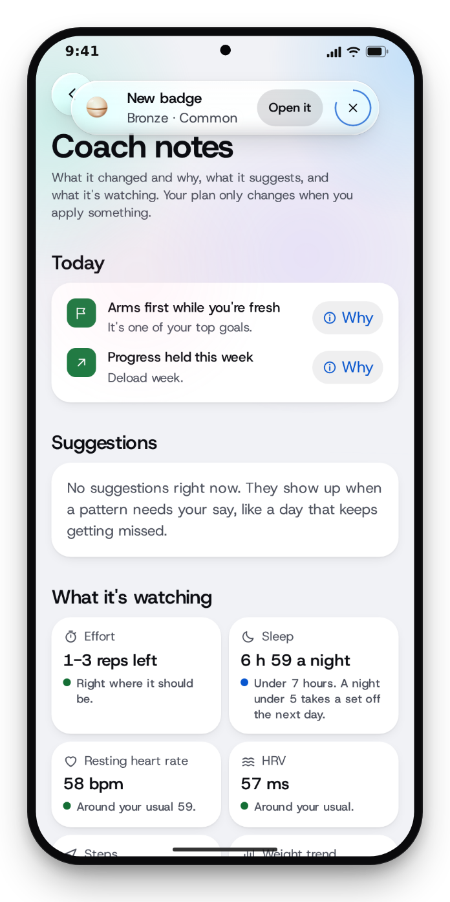

**Pick a size for the on-device coach** in the chat or in Settings. It's a one-time download that's verified, resumes where it left off and can wait for Wi-Fi.

| Size | Download | Good for |
|---|---|---|
| Fast | 533 MB | Starts answering soonest |
| Balanced | 1.28 GB | Reads your numbers better (6 GB of memory or more) |
| Best answers | 2.74 GB | The most thoughtful answers (12 GB of memory) |

Small models can slip, so the app checks every answer against your own numbers and leaves out what it can't back up.

## Made to feel good

- **Liquid glass** over soft colours that drift behind each page.
- **Controls you can feel.** Switches, segmented controls and the tab bar rise into a lens under your finger and land with a little squash, and they catch every tap, even a wobbly one.
- **Glass that moves.** Buttons form out of the glass and reshape with their labels, menus grow out of the button you tap, and the top bar's buttons carry over between pages.
- **Pages, cards and sheets** glide in and out, and sheets follow your finger from a glance to full height.
- **Smooth scrolling,** with or without the glass: Auto, Liquid, Frosted or Flat, in Settings under Look. Pages don't zoom by accident; maps do, with two fingers.
- **59 distinct haptics** (each tab, the end of a stepper, a finished set, a new best, each crack of a badge, every split of a run) in Light, Medium or Strong. Try each one in Settings.
- **Cancelling a workout** folds the player away, and a discarded activity folds away too.
- **3D figures show at once,** with a picture of the move until it starts, even right after an update.
- **Messages come up from the bottom,** above any buttons there, and a swipe down clears one. Dropdowns fold open and shut.
- **For everyone:** light and dark themes, bigger text, reduced motion and increased contrast.

## Built on research

Every rule the app follows, from your sets to your rest, is listed in the app under training, recovery, food and habits. Each has a one-line summary, the studies behind it and how strong the evidence is. Where the research is thin, it says so.

  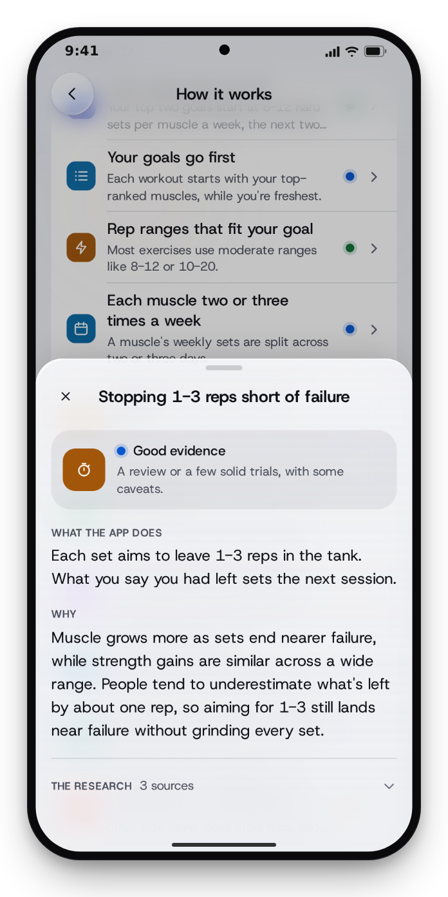
  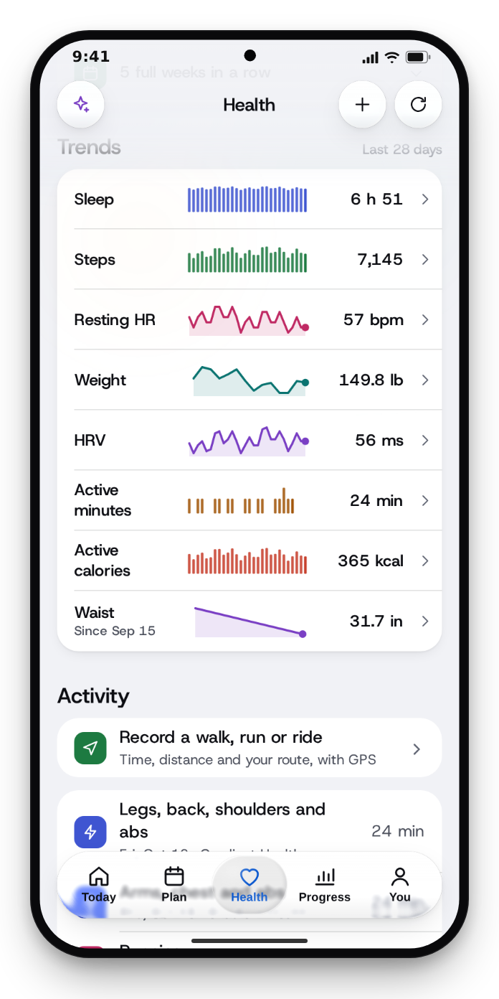

## Privacy

No account, no ads, no analytics. Everything stays on your phone, except what you choose to send:

- a summary you send to Claude (you see exactly what it says first)
- the words or barcode of a food you look up online
- the one-time download of the on-device model
- a plan you share with someone
- map tiles for the area around an activity, from OpenFreeMap, when maps are on (tiles you've seen are kept, and fetched again only after OpenFreeMap updates its map)
- a daily check with GitHub for a new version, if you allow it: GitHub sees your IP address and which version you have, nothing about you (the Google Play version doesn't check)

The [privacy policy](docs/PRIVACY.md) lists every piece of data and where it goes.

## Get it

1. Download `gradient-health.apk` from the [latest release](../../releases/latest).
2. Open it on your phone. You may need to allow installs from your browser or file manager.
3. After that, the app updates itself: say yes when it asks, or tap Check for updates in Settings, About. Each update is checked against the release, installs over the old version and keeps your data. The APKPure version is the same app with the same key, so you can switch between them.

| Needs | |
|---|---|
| The app | Android 8.0 or newer |
| Health Connect | Android 14 or newer (on older phones, log sleep and weight by hand) |
| The on-device AI's fast engine | A 64-bit phone, which is nearly every phone since 2017 |

> Gradient Health isn't medical advice. If you have a condition or an injury, check with a doctor before you start.

## Credits

### Refract

Every screen is built with **Refract**, the liquid glass design system: its glass, controls, motion, icons and type. The app credits it in Settings, under About.

### Open-source projects

| Project | Used for | License |
|---|---|---|
| Host Grotesk, Geist Mono | Fonts | SIL Open Font License 1.1 |
| three.js | 3D figure | MIT |
| Anthropic TypeScript SDK | The Claude coach | MIT |
| wllama and llama.cpp | On-device AI runtime | MIT |
| Qwen3.5 | On-device AI models, downloaded on request | Apache 2.0 |
| barcode-detector and zxing-wasm | Barcode reading | MIT |
| ZXing C++ | Barcode reading | Apache 2.0 |
| USDA SR28 | Built-in food list | Public domain |
| Open Food Facts | Online food search, when it's on | Open Database License |
| MapLibre GL JS | Activity maps | BSD 3-Clause |
| OpenStreetMap contributors and OpenMapTiles, served by OpenFreeMap | Map data, when maps are on | Open Database License and CC BY 4.0 |

The same list is in the app, under Settings, About, Open-source licenses.
